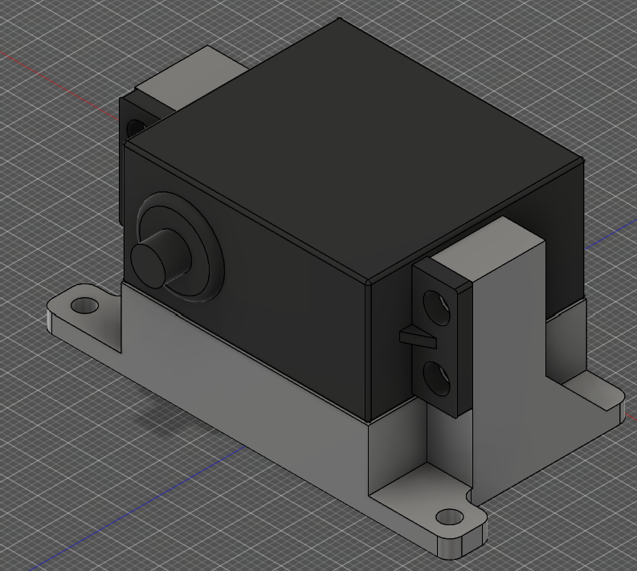

# Content guide

This guide shows where to put your own text, links, images and 3D models. For the design rules, see [DESIGN.md](DESIGN.md).

There are two content files:

| File | What it is |
|---|---|
| `index.html` | The homepage: hero, project tiles, about, skills, contact |
| `projects/ip-2025-servo-mount.html` | The servo mount project page |

`projects/project-template.html` is the blank copy for new hardware projects. Only edit it to change *every future* page.

**Find what's left:** anything still to replace is in `[square brackets]`. Search both files for `[`. Each part of a page starts with a banner comment like `<!-- ===== About ===== -->`, so search for the section name too.

**Preview:** run `python -m http.server` in the repo folder, open http://localhost:8000 and refresh after each save.

---

## Homepage (`index.html`)

### Tab title and search snippet
At the top, in `<head>`:
- `<title>`: the browser tab text.
- `<meta name="description" content="…">`: the text Google shows under the link.

### Header (`===== Header / navigation =====`)
- `<span class="status">Open to internships</span>` is the pill with the green dot. Change the text or delete the whole `<span>`.
- `<button class="theme-toggle">` is the light/dark switch. Visitors start in their system's mode, and the site remembers their choice.
- **This header is copied into every page.** If you change it, make the same change in each file in `projects/`, including the template.

### Hero (`===== Hero =====`)
| Element | What to change |
|---|---|
| `<p class="hero-kicker">` | The small line above your name |
| `<h1><span>Matteo</span> <span>De Liquori</span></h1>` | Your name. Each `<span>` is one line |
| `<p class="lead">` | The intro paragraph under your name |
| `<a href="assets/docs/CV.pdf" …>Download CV</a>` | Points at your CV file, see [Files](#files-and-how-theyre-linked) |
| `<dl class="title-block">` | The drawing title block in the corner. Each row is `<dt>label</dt><dd>value</dd>` |
| `<svg class="sheet-drawing …">` | The two gear views on the sheet, see [Drawing views](#drawing-views-on-the-homepage) |

### Drawing views on the homepage
The sheet shows the stand-in gear (`zahnrad-14`) twice: an iso view in the top right, and a front view with section A–A and dimensions in the bottom left. The dimensions are measured from the model: Ø32 tip, Ø23 root, 20 wide, Ø3.2 bore with a flat at 2.7, module 2, 14 teeth.
- The part outlines are generated by `tools/mesh-to-svg.py`, which prints the visible edges of a `.3mf` as SVG path data:
  ```
  python tools/mesh-to-svg.py path/to/part.3mf iso     # or top, front, right
  ```
  Paste the printed `viewBox` onto the `<svg>` and the `d` into the `<path class="edge">`.
- The section, centre lines and dimensions in the bottom strip are drawn by hand in mm. To show a different part, ask Claude to redraw them from the new part's sizes.

### Project tiles (`===== Projects =====`)
Each project is one `<article class="project-card">`:

```html
<article class="project-card" data-type="hardware">          <!-- "hardware" or "software", used by the filter -->
  <div class="card-plate">
    
  </div>
  <h3><a href="projects/ip-2025-servo-mount.html" class="card-link">Servo mount</a></h3>
  <p>One line on what it is.</p>
  <div class="card-meta"><span class="tag">Hardware</span></div>
</article>
```

- **Title:** the text inside `<h3>`. The `card-link` makes the whole tile clickable.
- **Summary:** the `<p>`. Keep it to one line. It's hidden on phones.
- **Image:** `src` is the file and `alt` describes the image for screen readers. The tile is square and the image is cropped to fill it.
- **Tags:** each `<span class="tag">` is one label.

A tile with **no page yet** has `class="project-card is-soon"`, no `card-link`, and a "soon" tag:

```html
<article class="project-card is-soon" data-type="hardware">
  …
  <h3>AMZ bracket</h3>
  …
  <div class="card-meta"><span class="tag">Hardware</span><span class="tag tag-soon">Write-up soon</span></div>
</article>
```

**When the page exists:**
1. Remove `is-soon`.
2. Wrap the title in `<a href="projects/<page>.html" class="card-link">…</a>`.
3. Delete the `tag-soon` span.

Running `/new-project` in Claude Code does this for you.

**Software tiles** show a faint code snippet (`<pre class="code-plate">`) instead of an image. Edit the snippet freely, or swap it for an `` like the hardware tiles.

### About (`===== About =====`)
- **Photo:** `` shows `assets/images/profile/profile2.png`, cropped to 4:5 around the face. To change it, save a new photo under the same name. If it isn't square, update the `width` and `height` on the `` to its pixel size.
- **Text:** the `<p class="serif">` paragraph. Add more paragraphs as more `<p class="serif">…</p>` lines.

### Skills (`===== Skills =====`)
There are three columns. Each has an icon (`<svg>`), a heading (`<h3>`) and a list (`<li>` per skill). Edit the text. Leave the `<svg>` alone unless you want different icons.

### Contact (`===== Contact =====`)
- **Email:** change it **in two places on the same line**, the `mailto:` address and the visible text:
  ```html
  <a href="mailto:you@domain.com" class="contact-mail">you@domain.com</a>
  ```
- **LinkedIn:** replace `yourprofile` in `https://www.linkedin.com/in/yourprofile`.
- **GitHub** is already set to `https://github.com/mdeliquori`.
- The short line next to the "Contact" heading is the `<p>` in `<div class="section-head">`.

---

## Project page (`projects/ip-2025-servo-mount.html`)

### Tab title and search snippet
`<title>` and `<meta name="description">` in `<head>`.

### Model stage (`===== Model stage =====`)
This is the opening screen. The model turns as you scroll and the text beside it changes.

| Element | What to change |
|---|---|
| `<p class="model-kicker">` | The line above the title, e.g. `Hardware project, IP 2025` |
| `<h1>` | The project title |
| `<model-viewer src="…" poster="…" alt="…">` | The 3D model, see [3D models](#3d-models) |
| `<li class="model-step">` | One per scroll step: a heading `<h2>` (keep the `step-index` number) and a `<p>` |
| `<p class="model-side-label">` | The vertical label on the right edge |
| `<span class="model-count">01 / 04</span>` | Change the total if you change the number of steps. The script updates the current number |

**Writing the steps:**
- Each `<p>` sits beside the model, so keep it to **1–2 sentences**. The long version goes in the write-up below.
- You can add or remove `<li class="model-step">` items. The scroll length and the 360° turn adjust themselves.

### Gallery (`===== Gallery =====`)
Each image is a `<figure>`:

```html
<figure>
  
  <figcaption>The mount on its own.</figcaption>
</figure>
```

Two figures sit side by side. Add more `<figure>` blocks and they wrap into rows of two. Images are cropped to 4:3.

### Write-up (`===== Write-up =====`)
| Element | What to change |
|---|---|
| `<dl class="meta-strip">` | Role / Team / Year / Tools. Each is `<dt>label</dt><dd>value</dd>`. Labels can be changed too |
| `<div class="writeup">` (×3) | Overview, Design & analysis, Results. A heading `<h2>` plus `<p class="serif">` paragraphs. Add as many paragraphs as you need |
| `<dl class="figures">` | Three key numbers, e.g. `<dt>Mass</dt><dd>42 g</dd>`. Delete any `<div>` you don't need |

Only put real numbers in the key figures. If you don't have one yet, leave the placeholder or delete that `<div>`.

---

## Files and how they're linked

### Where files live
```
assets/
  images/profile/profile2.png                 About photo
  images/projects/<project>/<file>.png        Project renders and photos, one folder per project
      ip-2025/ip-2025-servo-mount.png
      ip-2025/ip-2025-servo-mount-servo.png
      amz/amz-bracket.png
      sml/                                    (empty)
      hackathon/                              (empty)
  renders/<model>-poster.png                  Still image of each 3D model (transparent PNG)
  models/<model>.glb                          3D models for the model stage
  docs/CV.pdf                                 Your CV
tools/3mf-to-glb.py                           Converts a .3mf export to .glb
tools/mesh-to-svg.py                          Draws a .3mf as SVG linework for the homepage views
```

### Paths depend on which file you're in
| In this file | Write paths like |
|---|---|
| `index.html` (repo root) | `assets/images/projects/ip-2025/ip-2025-servo-mount.png` |
| `projects/*.html` (one folder down) | `../assets/images/projects/ip-2025/ip-2025-servo-mount.png` |

The `../` means "go up one folder". It applies to every image, model, poster and stylesheet in `projects/`. Links back to the homepage work the same way: `../index.html#contact`.

### Name files in lowercase with hyphens
Use names like `ip-2025-servo-mount.png`, not `IP_2025 ServoMount.PNG`.
- **Why:** the live site (GitHub Pages) is case-sensitive but Windows isn't. A link to `Mount.png` works on your PC, then shows a broken image online if the file is called `mount.png`.
- Avoid spaces and `+` in names too.
- Claude Code checks every link after it edits a page. If you edit by hand, double-check the spelling.

### Swapping a placeholder image
The easiest way is to **save the new image under the same name**, overwriting the old file. No HTML change is needed. If you use a new name, update every `src` that points to it. The servo-mount renders are used both in `index.html` (tile) and on the project page (gallery). Update the `alt` text if the image content changed.

Renders with a dark or transparent background sit better on the dark site than the light Fusion grid.

---

## 3D models

The model stage only plays **`.glb`** files. Keep each under ~10 MB.

### Getting a `.glb`
- **From a `.3mf`** (e.g. a Fusion export), use the converter in this repo:
  ```
  python tools/3mf-to-glb.py path/to/part.3mf assets/models/servo-mount.glb assets/renders/servo-mount-poster.png
  ```
  It does four things:
  - centres the part,
  - converts mm to metres,
  - turns it so it stands upright,
  - writes the `.glb`.

  If you give it the third argument, it also saves the 3MF's built-in thumbnail as the poster.
  - The thumbnail has a white background. To make it transparent, ask Claude, or use any image editor.
  - The converter handles single-body 3MF files and applies a plain grey metal finish.
- **From STEP/STL:** convert to `.glb` first, e.g. in Blender (File › Export › glTF 2.0, format "glTF Binary").

### Linking it on the project page
In `<model-viewer>`:

```html
<model-viewer
  src="../assets/models/servo-mount.glb"
  poster="../assets/renders/servo-mount-poster.png"
  alt="3D model of the servo mount"
  …>
```

| Attribute | What it does |
|---|---|
| `src` | The `.glb` file |
| `poster` | The still image shown until the model loads |
| `alt` | Describes the model for screen readers |

Leave the other attributes as they are; they set lighting and camera. If the model looks too dark or bright, adjust `exposure="0.95"`, where higher is brighter.

The stand-in gear (`assets/models/zahnrad-14.glb`, `assets/renders/zahnrad-14-poster.png`) can be deleted once no page uses it.

---

## Adding a new project
In Claude Code, run `/new-project <name>`. It does these four things:
1. copies the template,
2. fills in what you give it,
3. adds the homepage tile,
4. checks the links.

By hand:
1. Copy `projects/project-template.html` to `projects/<project-name>.html`.
2. Fill it in using the sections above.
3. Add or update its tile in `index.html`.
4. Put its images in `assets/images/projects/<project-name>/`.

Only **hardware** projects have a template so far. Software projects (code + GitHub link, no 3D) will get their own.
